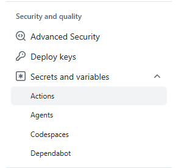
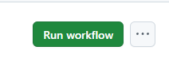

# Conduit Container Deployment

This project shows a simple CI/CD deployment workflow using github actions to automatically build a fullstack setup and deploy it on a remote machine over SSH without manual intervention.
The frontend image uses a pre existing Repo built with Angular while the backend image consists of a Django REST aaplication and a Postgres DB.

## Table of Contents

- [Conduit Container Deployment](#conduit-container-deployment)
- [Prerequisites](#prerequisites)
- [Known Issues](#known-issues)
- [Quickstart](#quickstart)
- [Project Structure](#project-structure)
- [Usage](#usage)
  - [Steps and Configuration](#steps-and-configuration)
  - [Image tags](#image-tags)
  - [Modifying Behavior](#modifying-behavior)
    - [Enable debug mode](#enable-debug-mode)
    - [Change access ports](#change-access-ports)
    - [Security](#security)

## Prerequisites

1. Docker engine and Docker compose must be installed on the host.

2. SSH access is setup on the host.

## Known Issues

### End-of-life Python runtime (inherited from upstream)

The backend is pinned to an end-of-life Python runtime (3.6), which reached EOL in December 2021 and no longer receives security updates.
The application's dependencies are fixed by the upstream repository and require an old interpreter:

```bash
Django==1.10.5
django-cors-middleware==1.3.1
django-extensions==1.7.1
djangorestframework==3.4.4
PyJWT==1.4.2
six==1.10.0
```

Django 1.10.5 (released 2017) only supports Python 2.7, 3.4 and 3.5 (though it runs on 3.6 with warnings), and does not run on modern Python releases. Matching the container base image to the dependencies (python:3.6-slim) is what allows the application to run unmodified. The container works as intended, but the runtime receives no security patches.

This also makes it difficult to add certain security features to the workflow. More information in the [Security](#security) section.

## Quickstart

1. Fork or clone the repository into your Github account. All workflows run within GitHub Actions.

2. Configure GitHub Secrets.

3. Trigger the deployment and wait for it to complete successfully.

4. Your Angular frontend will now be reachable under: <VM_IP>:<FRONTEND_PORT> and you can complete the fullstack website setup by accessing the Django backend <VM_IP>:<BACKEND_PORT>/admin.

## Project Structure

- ".github/workflows" : Contains the GitHub Actions workflow yml file that configures the automatic build and deployment.
- ".docs" : Contains any relevant documents (Project checklist).
- ".gitignore" : Prevents irrelevant files from being committed.
- "docker-compose.yaml" : A configuration file for Docker to define the necessary services such as the backend image, postgres db image, frontened image, port mapping, volumes, etc.
- "example.env" : Contains example environment variables to setup the project such as database credentials and non critical configuration values kept out of the Compose file.
- "README.md" : This document. Contains instructions on how to customize and deploy the workflow.
- "backend/conduit-backend" : Contains all necessary files to build the Django backend, including the Dockerfile and .dockerignore.
- "fronted/conduit-frontend" : Contains all necessary files to build the Angular frontend, including the Dockerfile and .dockerignore.

## Usage

Here you will find instructions on how to setup GitHub Secrets and make any changes to the .env files.
The entire project is setup to be hands off so you will not need to manually interact with Docker or the server itself.
(For more information on the fullstack project itself you can check out my other Repository : <https://github.com/MajoNeko/ConduitContainer>)

### Steps and Configuration

1. Fork or clone the repository into your Github account. All workflows run within GitHub Actions.
(Optional): If you want to make any alterations before running the wokflow, you can clone the repository locally using the following command:

```bash
git clone git@github.com/MajoNeko/ConduitDeployment
cd ConduitDeployment
```

2. Configure Github Secrets to allow the workflow to correctly obtain the necessary variables.
To configure Github Secrets, click on "Settings" in your Repo and then under "Security and quality" click on "Secrets and variables" and select "Actions"



Here you can add, edit or remove secrets from the repository.
The following secrets are necessary to run the workflow:

| Secret Name       | Description                                                     |
| ----------------- | --------------------------------------------------------------- |
| `VM_IP`           | Public IP or hostname of the server                             |
| `VM_USER`         | SSH username on the server                                      |
| `SSH_PRIVATE_KEY` | Private SSH key used for deployment                             |
| `VM_SSH_PORT`     | SSH port (usually `22`)                                         |
| `ENV_FILE`        | Full `.env` file content (Docker Compose environment variables) |

> [!Note]
> For added security, create a seperate SSH key pair for this workflow for the SSH_PRIVATE_KEY than the one normally used to login to the VM
> [!Note]
> For an example of the ENV_FILE you can look at example.env

3. Trigger the deployment manually by going to the Actions tab in the repository, selecting the workflow on the left side panel and clicking on the "Run Workflow" button on the right side:



The workflow will also run automatically when:

- a commit is pushed to the mian branch
- a pull request is merged into main

The workflow will now:

- build the backend and frontend images with an SHA tag
- push the images to GitHub Container Registry (GHCR)
- sign the images using cosign for added security
- copy the compose file to the VM
- connect to the server via SSH
- create the .env file on the host
- start the application using docker compose
- if something fails during this step, a rollback will be preformed with the previous running images. (On frist run, the rollback will simply log and fail as there are no previous images to fallback on.) Rollback only restores the application images so a migration applied by a failed deploy is not undone.
- wait for the application to be reachable (for about 2.5 minutes) or return an exit code 1 on failure. On failure the last 100 lines of log output from every service will be print for easier debugging.

4. Access the frontend through <VM_IP>:<FRONTEND_PORT> (default is 8282)

### Image tags

Tags are generated using `docker/metadata-action`. The image name comes from `${REGISTRY}/${repository_owner}/${REPO}-frontend` (and -backend`), with the repository owner lowercased automatically, since GHCR rejects uppercase paths.

| Tag Rule                            | Example                           | When it is produced       |
| ----------------------------------- | ------------------------------------------------------------- |
| `type=raw,value=latest`             | `conduit-backend:latest`          | Every build               |
| `type=sha,format=short,prefix=sha-` | `conduit-backend:sha-b6deba8`     | Every build               |
| `type=sha,format=long`              | `conduit-backend:b6deba88d09c...` | Every build               |
| `type=ref,event=branch`             | `conduit-backend:efeatue`         | Pushes to a branch        |
| `type=semver,pattern={{version}}`   | `conduit-backend:1.2.3`           | Git tag matching `v*.*.*` |

There are three SHA based tags which are are used for deployment. It is immutable and is what the deploy script pins. 
The `latest` tag will always point to the most recent build.
Branch tags are used for convenience and are not suitable for pinning as they move forward on each build.
The `semver` tag will only appear when a git tag is pushed, for example `v1.2.3`. If you never tag release, that rule will produce nothing.

### Modifying Behavior

- #### Enable debug mode

    Set DJANGO_DEBUG=1 in the .env file, then restart.

- #### Change access ports

  You can change the frontend or backend access ports by altering the value under FRONTEND_PORT or BACKEND_PORT in the .env file.

- #### Security

  For added security you can scan the image for vulnerabilities. In this project, the given frontend and backend repositories are based on older versions of their respective stacks and scans will fail. For an updated stack the following section can be added to the workflow Actions:

  ```bash
    #########################################################################################################
    # Scan image for safety before pushing to Repo
    # - name: Scan backend image with Trivy
    #  uses: aquasecurity/trivy-action@v0.36.0
    #  with:
    #    image-ref: ${{ steps.imageName.outputs.image }}:${{ github.sha }}
    #    format: table
    #    severity: HIGH,CRITICAL
    #    exit-code: '1'
    #    ignore-unfixed: true
    #########################################################################################################
  ```
  